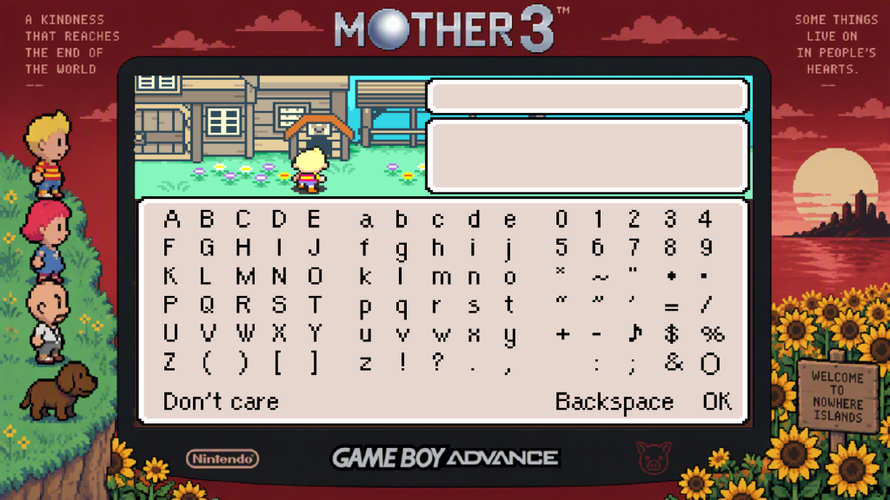
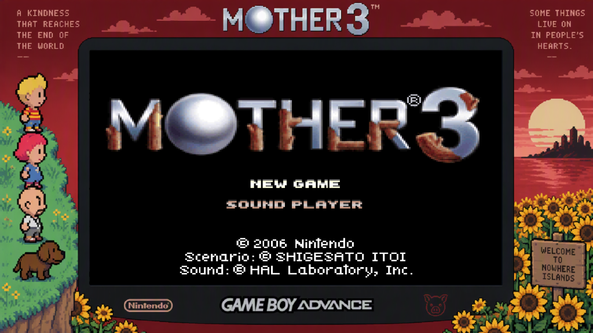

# MOTHER 3 Native Port (Recompilation) v1.0.2

A native multi-platform port of **MOTHER 3** featuring the official **MOTHER 3 Fan Translation v1.3 (English)** with native support for the **High-Quality 16-Bit Sound Mixing Mod**, clean fullscreen mode, and dedicated packages for **Windows**, **Linux**, and **Android**.

Unlike conventional emulation, this project statically recompiles the original Game Boy Advance ARM/Thumb machine code into native C++ instructions. The resulting binary executes natively on modern hardware with ultra-low latency, full analog movement, optional decorative bezel framing, integer scaling, and instant save state controls.

---

<p align="center">
  
</p>

<p align="center">
  
</p>

---

> [!IMPORTANT]
> **ENGLISH-PATCHED ROM REQUIRED**:
> This software does **NOT** contain, distribute, or bundle any copyrighted Nintendo game data, ROM files, or BIOS dumps.
> On first launch, the program boots into the built-in launcher where you must provide your legally dumped **MOTHER 3 ROM** (patched with the v1.3 English translation) and your **GBA BIOS dump**.

---

## 1. What's New in v1.0.2

* **Clean Fullscreen / No Borders Mode**:
  - Want to play in full screen without the decorative border artwork? Press **`F10`** at any time during gameplay to toggle between the **1080p Sunset & Party Bezel** and **Clean Fullscreen Mode (No Borders)**!
  - You can also set `bezel = 0` under `[Launcher]` in `config.ini` to launch directly in clean fullscreen mode by default.
* **Classic Display Profile Compatibility**:
  - Addressed driver-level black screen reports when selecting the "Classic" color profile by decoupling the viewport scaling and texture blend fallbacks.
* **Separate Multi-Platform Packages & Forks**:
  - Dedicated releases are now downloadable individually:
    - **Windows (x64)**: [`Mother3Recomp-v1.0.2-windows-x64.zip`](https://github.com/josiahg2502-glitch/Mother3Recomp/releases/tag/v1.0.2)
    - **Linux (x86_64 / Steam Deck)**: [`Mother3Recomp-v1.0.2-linux-x86_64.tar.gz`](https://github.com/josiahg2502-glitch/Mother3Recomp/releases/tag/v1.0.2)
    - **Android (ARM64)**: [`Mother3Recomp-v1.0.2-android-arm64.apk`](https://github.com/josiahg2502-glitch/Mother3Recomp/releases/tag/v1.0.2)
  - Dedicated repository forks:
    - Android Port Repository: [josiahg2502-glitch/Mother3Recomp-Android](https://github.com/josiahg2502-glitch/Mother3Recomp-Android)
    - Linux Port Repository: [josiahg2502-glitch/Mother3Recomp-Linux](https://github.com/josiahg2502-glitch/Mother3Recomp-Linux)

---

## 2. Requirements

### Game & Asset Requirements
To play, you must provide your own legitimate dumps of:
1. **MOTHER 3 ROM (English Patched v1.3)**:
   - **Standard English v1.3**: SHA-1: `306fb8874533b0fd0796208faa8bed2db4ae77fb`
   - **English v1.3 + High-Quality Sound Mixing**: SHA-1: `4ffe71ce5c5e1e8d9be5fbd09968b60787169b21`
   - *OR* **Clean Japanese ROM** (`A3UJ` / SHA-1: `4f0f493e12c2a8c61b2d809af03f7abf87a85776`) **+** the official `mother3.ups` patch file from the [MOTHER 3 Fan Translation website](http://mother3.fobby.net/). The built-in launcher includes an automatic UPS patcher that verifies and applies the patch on the fly without modifying your original file.
2. **Game Boy Advance BIOS Dump**:
   - `gba_bios.bin` (16 KB retail dump / SHA-1: `300c20df6731a33952ded8c436f7f186d25d3492`).

### System Requirements
| Component | Minimum | Recommended |
| :--- | :--- | :--- |
| **Operating System** | Windows 10/11 (64-bit), Linux (glibc 2.35+ / SteamOS), Android 8.0+ | Windows 11 (64-bit) / SteamOS |
| **Processor** | x86-64 Dual-Core CPU with SSE2 / ARM64 v8a | x86-64 Quad-Core CPU with AVX2 |
| **Memory (RAM)** | 512 MB RAM | 2 GB RAM |
| **Graphics** | Direct3D 11, OpenGL 3.2+, or Vulkan compatible GPU | Direct3D 11 / Vulkan |
| **Storage** | 100 MB available space | 500 MB available space |
| **Input Devices** | Keyboard / Touchscreen | Xbox, PlayStation, Switch Pro, or XInput/DirectInput gamepad |

---

## 3. First-Time Setup & Quick Start

### Windows (PC)
1. Download [`Mother3Recomp-v1.0.2-windows-x64.zip`](https://github.com/josiahg2502-glitch/Mother3Recomp/releases/tag/v1.0.2) and extract it anywhere on your PC.
2. Run **`Play Mother 3.cmd`** or **`Mother3Recomp.exe`**.
3. In the Launcher:
   - Click **Select GBA BIOS dump** and choose your `gba_bios.bin`.
   - Click **Select game ROM (.gba)** and choose your English-patched `MOTHER 3 (English v1.3).gba`.
   - *(Optional)* If using a clean Japanese ROM, tick **ROM patch** and select `mother3.ups`.
4. Configure display and controller settings if desired, then click **Play**.

### Linux & Steam Deck
1. Download [`Mother3Recomp-v1.0.2-linux-x86_64.tar.gz`](https://github.com/josiahg2502-glitch/Mother3Recomp/releases/tag/v1.0.2) and extract it:
   ```bash
   tar -xzf Mother3Recomp-v1.0.2-linux-x86_64.tar.gz
   cd Mother3Recomp-Linux
   ```
2. Place `gba_bios.bin` in `bios/` and your ROM in `roms/`.
3. Make the launcher executable and run:
   ```bash
   chmod +x run_mother3.sh build_linux.sh
   ./run_mother3.sh
   ```
4. *Steam Deck*: Add `run_mother3.sh` as a Non-Steam Game in Steam for full Game Mode handheld play!

### Android
1. Download [`Mother3Recomp-v1.0.2-android-arm64.apk`](https://github.com/josiahg2502-glitch/Mother3Recomp/releases/tag/v1.0.2) and install it on your device.
2. Open the app; the `Mother3SetupActivity` will prompt you to select your `mother3_en.gba` and `gba_bios.bin` files.
3. Once verified, the game launches natively with full touch and Bluetooth gamepad support!

---

## 4. Controls & Hotkeys

### Gameplay Controls
| Action | Keyboard | Controller (Xbox / PC) | DualShock / DualSense |
| :--- | :--- | :--- | :--- |
| **Movement** | Arrow Keys | **Left Analog Stick** / D-Pad | **Left Analog Stick** / D-Pad |
| **A (Confirm / Talk)** | `X` | `A` | `Cross` |
| **B (Cancel / Dash)** | `Z` | `B` | `Circle` |
| **L (Quick text / Info)** | `C` | `X` / `LB` | `Square` / `L1` |
| **R (Map)** | `V` | `Y` / `RB` | `Triangle` / `R1` |
| **Start (In-Game Menu)**| `Enter` | `Start` | `Options` |
| **Select (Wake Sleep)** | `Right Shift`| `Back` / `View` | `Share` / `Touchpad` |

> [!TIP]
> **Sleep Mode Wake**: If the game enters sleep mode (screen goes dark), press **`L + R + Select`** (`C + V + Right Shift` or `LB + RB + Back`) to wake it, matching authentic GBA hardware behavior.

### System Hotkeys
| Hotkey | Action | Behavior |
| :--- | :--- | :--- |
| **`F10`** | **Toggle Bezel / Borders** | Toggles dynamically between the custom Sunset & Party Bezel and Clean Fullscreen (No Borders) mode. |
| **`F11`** | **In-Game Overlay Menu** | Opens/closes the recomp overlay menu for settings, audio, and display adjustments without closing the game. |
| **`Esc`** | **Instant Clean Exit** | Cleanly saves battery save data (SRAM/Flash) to disk and shuts down the game process immediately. |
| **`F1`** | **Quick Save State** | Saves state to Slot 1 instantly without pausing gameplay. |
| **`F2`** | **Quick Load State** | Loads state from Slot 1 instantly. |
| **`1` (Hold)** / **`LT`** | **Rewind** | Rewinds gameplay by up to 30 seconds. |
| **`2` (Hold)** / **`RT`** | **Fast-Forward** | Accelerates game speed (4x multiplier by default). |

---

## 5. Visuals & Presentation

- **Clean Fullscreen & Border Options**: Press **`F10`** at any time to toggle borders off/on. In `config.ini`, set `bezel = 0` for borderless clean fullscreen by default or `bezel = 1` for the decorative border.
- **1080p Sunset & Party Bezel**: Integrates official full-HD decorative border artwork featuring Lucas, Kumatora, Duster, Boney, sunflowers, and the Nowhere Islands sunset.
- **3:2 Integer Scaling**: Maps the active GBA screen into a pixel-accurate 3:2 frame with hardware alpha blending and zero clipping of HUD elements or warning text.
- **8-Way Analog Movement**: Full 360-degree analog stick translation mapped to GBA 8-directional movement with custom deadzone calibration.

---

## 6. High-Quality Sound Mixing Mod

Mother3Recomp natively supports and bundles the celebrated **[High-Quality Sound Mixing Mod for Mother 3 (Fan Translations)](https://www.romhacking.net/hacks/6951/)** by Summer Dragonfly & ipatix.

- **How it works**: The original GBA hardware mixer mixes audio channels at 8-bit depth, producing the well-known "GBA hiss" and quantization noise. This hack replaces the mixer with 16-bit channel mixing before downsampling, giving Shogo Sakai's soundtrack crystal-clear audio clarity and fidelity.
- **Included in `mods/High-Quality Sound Mixing/`**:
  - **`apply_hq_sound_mod.bat`**: An automated one-click patcher that detects your English v1.3 ROM and outputs the High-Quality Audio ROM instantly.
  - **`mother3_hq_sound_mixing.ups`**: Official UPS patch file for use with the built-in launcher or external tools like Tsukuyomi or Flips.
- **Launcher Integration**: In the built-in launcher, choose your base English v1.3 ROM, select `mother3_hq_sound_mixing.ups` under **ROM Patch**, and play immediately.

---

## 7. Credits & Disclaimers

A full, detailed breakdown of all contributors, authors, libraries, and tools is available in [**`CREDITS.md`**](CREDITS.md).

- **MOTHER 3**: © 2006 Nintendo / SHIGESATO ITOI / Brownie Brown / HAL Laboratory, Inc. Music by Shogo Sakai.
- **English Fan Translation**: The MOTHER 3 Fan Translation Team ([mother3.fobby.net](http://mother3.fobby.net/)) — Clyde "Tomato" Mandelin, Jeffman, Reid Young, and contributors.
- **High-Quality Sound Mixing Mod**: Summer Dragonfly (@MusicTheorist) and ipatix ([Romhacking.net #6951](https://www.romhacking.net/hacks/6951/) / [MusicTheorist/MOTHER-3-HQ-Audio](https://github.com/MusicTheorist/MOTHER-3-HQ-Audio)), with foundational mixing code by Haruki "Bon" Kodera (Camelot) and decompilation support from Kurausukun & theo3.
- **Recompilation Technology**: Powered by `gbarecomp` and `recomp-ui` by Matthew Stanley ([@mstan](https://github.com/mstan)), licensed under PolyForm Noncommercial 1.0.0.
- **Android Port Lead**: **YlPorts** ([github.com/YlPorts/Mother3Recomp-Android](https://github.com/YlPorts/Mother3Recomp-Android)).
- **Third-Party Libraries & Runtimes**:
  - **SDL2**: Sam Lantinga & the SDL Team (zlib license)
  - **Dear ImGui**: Omar Cornut (MIT license)
  - **TinyCC**: Fabrice Bellard (LGPL 2.1 license)
  - **MinGW-w64 / GCC**: The MinGW-w64 Project Team

*This repository is a non-commercial, open-source educational preservation project. No commercial ROMs, BIOS files, copyrighted game audio, or Nintendo proprietary code are distributed.*
